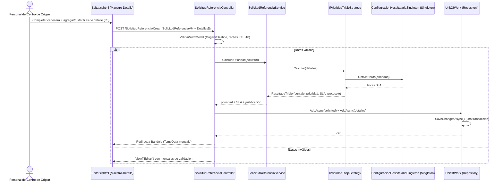
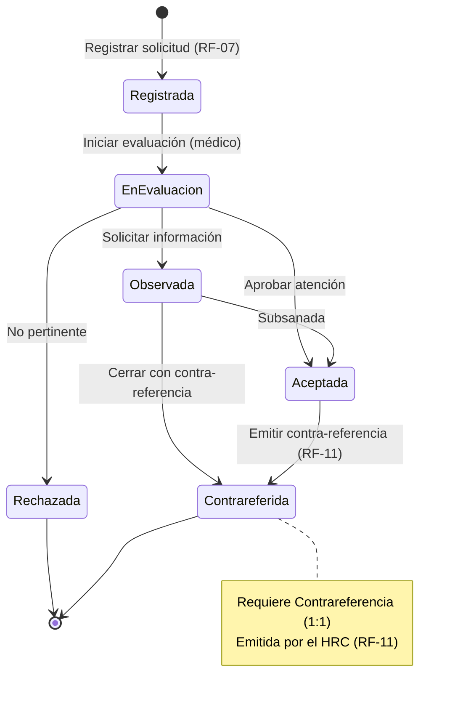
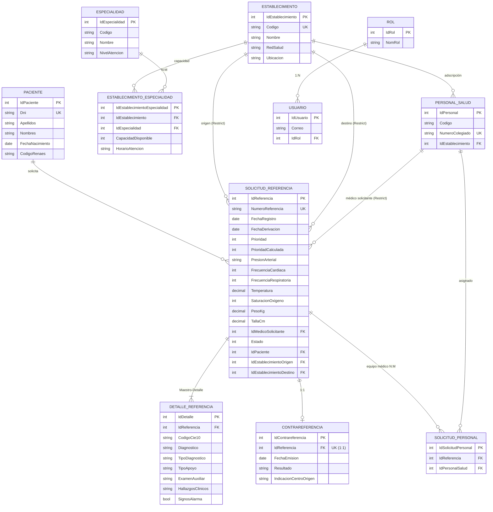

# DOCUMENTACIÓN T2 — Sistema de Referencias y Contra-referencias Interhospitalarias del Hospital Regional de Cajamarca (HRC)

**Curso:** Diseño y Arquitectura de Software
**Tecnología:** .NET 10 · ASP.NET Core MVC · Entity Framework Core 10
**Proyecto:** `PROYECTO_REFERENCIAS`
**Alcance de la evaluación:** Rúbrica T2 (Criterios 1.1, 1.2 y 2.1 y Semanas 1–9)

---

## 1. Análisis del Problema (Criterio 1.1)

### 1.1 Necesidades reales del HRC (6)

| # | Necesidad del HRC | Situación actual / problema |
|---|---|---|
| N1 | **Centralizar las solicitudes de referencia** de los centros de la red de Cajamarca | Las derivaciones se manejan por teléfono, oficio o papel, sin trazabilidad ni control de cupos. |
| N2 | **Clasificar y priorizar la urgencia** de cada referencia (triaje) | No existe un criterio uniforme de prioridad; los casos críticos se mezclan con consulta externa. |
| N3 | **Coordinar la respuesta de los establecimientos destino** | Se desconoce si el caso fue aceptado, observado o rechazado; no hay alerta de vencimiento (SLA). |
| N4 | **Cerrar el ciclo con la contra-referencia** al centro de origen | Muchos casos quedan "abiertos"; el centro de origen nunca recibe la evolución ni las indicaciones. |
| N5 | **Conocer la capacidad instalada** (especialidades y cupos por establecimiento) | No se sabe qué especialidad atiende en cada establecimiento ni su capacidad/horario. |
| N6 | **Disponer de indicadores de gestión** para la Dirección del HRC | No hay reportes de referencias por estado, prioridad ni red de salud para la toma de decisiones. |

### 1.2 Actores / Stakeholders (4)

| # | Actor | Rol en el sistema |
|---|---|---|
| A1 | **Administrador del HRC** (rol `Administrador`) | Mantiene catálogos, usuarios, establecimientos y especialidades; supervisa la red. |
| A2 | **Médico Evaluador del HRC** (rol `Empleado`) | Evalúa las referencias recibidas y cambia su estado (Aceptada/Observada/Rechazada). |
| A3 | **Personal del Centro de Salud de Origen** (rol `Usuario`) | Registra solicitudes de referencia y recibe la contra-referencia. |
| A4 | **Auditor / Dirección Médica** | Consulta el dashboard ejecutivo y audita las transiciones de estado. |

### 1.3 Requisitos Funcionales (15)

| ID | Requisito Funcional | Módulo / Componente real |
|---|---|---|
| RF-01 | Autenticar usuarios y autorizar por roles (Administrador / Empleado / Usuario). | `LoginController`, cookies + claims 
| RF-02 | Registrar, editar, listar y eliminar **Pacientes** con DNI/RENAES validado. | `PacienteController`, `Models/Paciente.cs` |
| RF-03 | Mantener **Establecimientos de Salud** con red y ubicación. | `EstablecimientoSaludController`, `Models/EstablecimientoSalud.cs` |
| RF-04 | Mantener **Especialidades** médicas (código CIE-10/interno, nivel). | `EspecialidadController`, `Models/Especialidad.cs` |
| RF-05 | Mantener **Personal de Salud** (colegiado, SIP, especialidad). | `PersonalSaludController`, `Models/PersonalSalud.cs` |
| RF-06 | Asignar especialidades a un establecimiento **N:M** con capacidad y horario. | `EstablecimientoSaludController.AsignarEspecialidades`, `Models/EstablecimientoEspecialidad.cs` |
| RF-07 | Registrar una **Solicitud de Referencia Maestro-Detalle** en una sola transacción. | `SolicitudReferenciaController.Crear`, `Repository/UnitOfWork.cs` |
| RF-08 | **Calcular automáticamente** la prioridad/triaje y el SLA según signos de alarma y diagnóstico. | `Service/SolicitudReferenciaService.cs`, `Service/Estrategias/TriageEstrategias.cs` |
| RF-09 | Consultar la **bandeja** de referencias con filtros por estado, prioridad, destino y texto. | `SolicitudReferenciaController.Index`, `Views/SolicitudReferencia/Index.cshtml` |
| RF-10 | **Evaluar** una referencia y cambiar su estado respetando la máquina de estados. | `SolicitudReferenciaController.Evaluar`, `Views/SolicitudReferencia/Evaluar.cshtml` |
| RF-11 | **Emitir la contra-referencia** (relación 1:1) con resultado e indicaciones. | `SolicitudReferenciaController.ContrareferenciaEmitir`, `Models/Contrareferencia.cs` |
| RF-12 | **Consultar** la contra-referencia emitida de una referencia. | `SolicitudReferenciaController.ContrareferenciaVer` |
| RF-13 | Visualizar un **Dashboard ejecutivo** de referencias por estado, prioridad y red. | `SolicitudReferenciaController.Dashboard`, `ViewModels/Dashboard/IndicadoresViewModel.cs` |
| RF-14 | Aplicar **validaciones de negocio** (Origen ≠ Destino, fechas coherentes, formato CIE-10). | `SolicitudReferenciaController.ValidarViewModel`, `Service/SolicitudReferenciaService.ValidarNegocioCorto` |
| RF-15 | Cargar **datos semilla** y parámetros normativos del HRC (SLA, CIE-10 frecuentes). | `Data/DataSeeder.cs`, `Service/ConfiguracionHospitalariaSingleton.cs` |

### 1.4 Requisitos No Funcionales (5)

| ID | Requisito No Funcional | Criterio verificable |
|---|---|---|
| RNF-01 | **Seguridad:** autenticación por cookies, autorización por roles y protección CSRF (`[ValidateAntiForgeryToken]`). | Todo controlador de negocio lleva `[Authorize]`; los POST sensibles usan antiforgery. |
| RNF-02 | **Rendimiento:** los listados operativos (bandeja, dashboard) responden en tiempos aceptables con índices. | Índices en `Estado`, `Prioridad`, `IdEstablecimientoDestino`, `NumeroReferencia` (único) y `CodigoCie10`. |
| RNF-03 | **Mantenibilidad:** separación en capas y patrón Repository / Unit of Work para aislar EF Core. | `Repository/IRepository.cs`, `Repository/EfRepository.cs`, `Repository/UnitOfWork.cs`. |
| RNF-04 | **Usabilidad:** interfaz institucional minimalista y responsiva (Bootstrap, bordes rectos, sin adornos). | `wwwroot/css/site.css` con `border-radius: 0 !important` global. |
| RNF-05 | **Integridad y trazabilidad:** auditoría de cambios de estado y SLA por prioridad. | Campos `FechaEstado`, `ObservacionEstado`, `ObservacionSistema`; SLA en `ConfiguracionHospitalariaSingleton`. |

### 1.5 Restricciones (5)

| ID | Restricción | Impacto técnico |
|---|---|---|
| R-01 | **Norma Técnica de Salud (NTS) MINSA** de Referencia y Contra-referencia. | La máquina de estados y los SLA siguen el flujo normativo (Registrada → En Evaluación → Aceptada/Observada/Rechazada → Contrareferida). |
| R-02 | **Ley N° 29733** de Protección de Datos Personales. | Datos clínicos mínimos; acceso restringido por rol; sin exposición de datos sensibles innecesarios. |
| R-03 | **Interoperabilidad** con RENAES / códigos CIE-10. | `Paciente.CodigoRenaes`, `DetalleReferencia.CodigoCie10` con validación de formato. |
| R-04 | **Infraestructura local** (sin presupuesto cloud). | Despliegue monolítico ligero; EF Core con SQL Server (producción) y SQLite (desarrollo). |
| R-05 | **Codificación única** de referencia con formato institucional. | `NumeroReferencia` con patrón `HRC-XXXX` (índice único). |

### 1.6 Alcance

**Incluido:** gestión de catálogos (Paciente, Establecimiento, Especialidad, Personal), relación N:M de capacidad por especialidad, registro Maestro-Detalle de referencias con cálculo automático de prioridad (Strategy), bandeja con filtros, evaluación y máquina de estados, emisión/consulta de contra-referencia (1:1), dashboard ejecutivo y datos semilla de la red de Cajamarca.

**Excluido (fuera de alcance):** facturación/SIS, integración en tiempo real con el HIS de ESSALUD, telemedicina y firma digital certificada.

---

## 2. Generación y Selección de Soluciones (Criterio 1.2)

### 2.1 Alternativas arquitectónicas evaluadas

**Alternativa A — Arquitectura en Capas MVC con Patrones de Diseño (IMPLEMENTADA).**
ASP.NET Core MVC organizado en Presentación (Controllers/Views), Dominio (Models, Service, Estrategias), Acceso a datos (Repository/UnitOfWork sobre EF Core) y Configuración (Singleton). Aplica patrones Strategy, Singleton, Repository, Unit of Work y GRASP.

**Alternativa B — Microservicios.**
Servicios independientes (Pacientes, Referencias, Contra-referencias, Catálogos) con API REST y gateway. Alta escalabilidad pero elevado costo operativo y de complejidad para un hospital con infraestructura local.

**Alternativa C — Monolito acoplado tradicional.**
Lógica de negocio, acceso a datos y presentación mezclados (EF Core directo en el controlador sin capas ni patrones). Rápido de iniciar pero difícil de mantener y probar.

### 2.2 Criterios técnicos verificables (6)

| Criterio | Peso | Justificación de la ponderación |
|---|---|---|
| Seguridad | 20% | El sistema maneja datos clínicos sensibles (Ley 29733). |
| Rendimiento | 15% | Uso hospitalario concurrente en horas punta. |
| Mantenibilidad | 20% | Requisito de evolución por Semanas 1–9 y rúbrica. |
| Escalabilidad | 10% | Crecimiento futuro a más redes de salud. |
| Costo | 15% | Presupuesto restringido del sector público. |
| Complejidad técnica | 20% | Equipo docente/estudiantes, curva de aprendizaje. |

### 2.3 Matriz Comparativa Ponderada

Escala de satisfacción: 1 (bajo) a 5 (alto). Puntaje = Σ (Peso × Valor).

| Criterio (Peso) | Alt. A (MVC+Patrones) | Alt. B (Microservicios) | Alt. C (Monolito acoplado) |
|---|---|---|---|
| Seguridad (20%) | 4 | 5 | 2 |
| Rendimiento (15%) | 4 | 5 | 2 |
| Mantenibilidad (20%) | 5 | 4 | 2 |
| Escalabilidad (10%) | 3 | 5 | 2 |
| Costo (15%) | 5 | 2 | 5 |
| Complejidad técnica (20%) | 4 | 2 | 5 |
| **Puntaje ponderado** | **4.25** | **3.75** | **3.05** |

**Cálculo:**
- A = 4·0.20 + 4·0.15 + 5·0.20 + 3·0.10 + 5·0.15 + 4·0.20 = **4.25**
- B = 5·0.20 + 5·0.15 + 4·0.20 + 5·0.10 + 2·0.15 + 2·0.20 = **3.75**
- C = 2·0.20 + 2·0.15 + 2·0.20 + 2·0.10 + 5·0.15 + 5·0.20 = **3.05**

**Decisión:** se adopta la **Alternativa A (Arquitectura en Capas MVC con Patrones)**, por su mejor equilibrio entre seguridad, mantenibilidad, costo y complejidad técnica, adecuado a la realidad del HRC y verificable en el código entregado.

---

## 3. Contexto y Matriz de Trazabilidad (Criterio 2.1)

### 3.1 Resumen del Documento Visión

El **Sistema de Referencias y Contra-referencias Interhospitalarias del HRC** es una solución web que digitaliza el flujo normativo de derivación de pacientes entre los establecimientos de la red de salud de Cajamarca y el Hospital Regional Docente de Cajamarca. El sistema centraliza el registro (Maestro-Detalle con diagnósticos CIE-10), calcula automáticamente la prioridad clínica y el tiempo máximo de respuesta (SLA), permite al HRC evaluar la referencia mediante una máquina de estados trazable y cierra el ciclo con la emisión de la contra-referencia al centro de origen. Su objetivo estratégico es reducir los tiempos de atención de casos críticos, eliminar la pérdida de información y dotar a la Dirección de indicadores de gestión confiables.

- **Visión:** ser la plataforma de gestión de referencias de la red de Salud Cajamarca.
- **Objetivo general:** digitalizar y trazar el ciclo completo referencia → evaluación → contra-referencia.
- **Objetivos específicos:** clasificar la urgencia automáticamente, garantizar SLA por prioridad, medir desempeño por red de salud.
- **Beneficios:** menor tiempo de derivación de casos críticos, trazabilidad auditable y visibilidad de la capacidad instalada.

### 3.2 Casos de Uso (10)

| ID | Caso de Uso | Actor | Relación UML |
|---|---|---|---|
| CU-01 | Iniciar sesión | A1/A2/A3 | `<<include>>` Validar credenciales y rol |
| CU-02 | Registrar paciente | A1/A3 | `<<extend>>` Validar DNI único |
| CU-03 | Mantener establecimientos y especialidades | A1 | `<<include>>` Asignar especialidad (N:M) |
| CU-04 | Registrar solicitud de referencia (Maestro-Detalle) | A3 | `<<include>>` Calcular prioridad (CU-05) |
| CU-05 | Calcular prioridad / triaje (Strategy) | Sistema | `<<extend>>` Ajustar prioridad manualmente |
| CU-06 | Consultar bandeja de referencias (filtros) | A1/A2 | `<<extend>>` Filtrar por estado/prioridad/destino |
| CU-07 | Evaluar referencia y cambiar estado | A2 | `<<include>>` Validar transición de estado |
| CU-08 | Emitir contra-referencia | A2 | `<<extend>>` si el estado es Aceptada u Observada |
| CU-09 | Consultar dashboard ejecutivo | A4 | `<<include>>` Agregar indicadores por red |
| CU-10 | Auditar transiciones de estado | A4 | — |

**Relaciones UML destacadas:**
- **Generalización:** el actor *Personal de Salud* generaliza a *Médico Evaluador* (A2) y *Personal del Centro de Origen* (A3).
- **`<<include>>`:** CU-04 incluye obligatoriamente CU-05 (cálculo de prioridad) y CU-07 incluye la validación de transición.
- **`<<extend>>`:** CU-08 extiende el flujo solo cuando el estado permite contrareferir; CU-02 extiende con la validación de DNI único; CU-06 extiende con el filtrado.

### 3.3 Matriz de Trazabilidad Completa

| Necesidad | RF | Caso de Uso | Componente real en el código (Clase / Controlador / Patrón) | Prototipo / Vista (6) |
|---|---|---|---|---|
| N1 | RF-07 | CU-04 | `SolicitudReferenciaController.Crear`, `DetalleReferenciaVM`, patrón **Maestro-Detalle + Unit of Work** | P3. Formulario Maestro-Detalle |
| N1 | RF-09 | CU-06 | `SolicitudReferenciaController.Index` (filtros EF Core) | P2. Bandeja de Solicitudes |
| N2 | RF-08 | CU-05 | `IPrioridadTriajeStrategy`, `TriajeEmergenciaPrioridadIStrategy`, `TriajeUrgenciaPrioridadIIStrategy`, `TriajeConsultaExternaPrioridadIIIStrategy`, `SolicitudReferenciaService.CalcularPrioridad` (patrón **Strategy**) | P3. Formulario Maestro-Detalle (prioridad calculada) |
| N2 | RF-15 | CU-05 | `ConfiguracionHospitalariaSingleton` (**Singleton**), `DataSeeder` | P3 / P6 |
| N3 | RF-10 | CU-07 | `SolicitudReferenciaService.ProcesarTransicionEstado` (**máquina de estados** / GRASP Controlador) | P4. Evaluación Médica / Auditoría |
| N4 | RF-11 | CU-08 | `SolicitudReferenciaController.ContrareferenciaEmitir`, `Models/Contrareferencia.cs` (**relación 1:1**) | P5. Emisión de Contra-referencia |
| N4 | RF-12 | CU-08 | `SolicitudReferenciaController.ContrareferenciaVer` | P5. Consulta de Contra-referencia |
| N5 | RF-06 | CU-03 | `EstablecimientoSaludController.AsignarEspecialidades`, `Models/EstablecimientoEspecialidad.cs` (**relación N:M**) | P6. Mantenimiento de Establecimientos y Especialidades |
| N5 | RF-03 | CU-03 | `EstablecimientoSaludController`, `Models/EstablecimientoSalud.cs` | P6. Mantenimiento de Establecimientos |
| N5 | RF-04 | CU-03 | `EspecialidadController`, `Models/Especialidad.cs` | P6. Mantenimiento de Especialidades |
| N6 | RF-13 | CU-09 | `SolicitudReferenciaController.Dashboard`, `IndicadoresViewModel` | P1. Dashboard Ejecutivo del HRC |
| N1/N2 | RF-14 | CU-07 | `SolicitudReferenciaController.ValidarViewModel`, `SolicitudReferenciaService.ValidarNegocioCorto` | P3 / P4 |
| — | RF-02 | CU-02 | `PacienteController`, `Models/Paciente.cs` | P6. Mantenimiento de Pacientes |
| — | RF-05 | CU-03 | `PersonalSaludController`, `Models/PersonalSalud.cs` | P6. Mantenimiento de Personal de Salud |
| — | RF-01 | CU-01 | `LoginController`, `Program.cs` (cookies + roles), `Rol`, `Usuario` | Login / Seguridad |
| — | RF-10 | CU-10 | `ObservacionEstado`, `FechaEstado`, `ObservacionSistema` (`SolicitudReferencia`) | P4. Evaluación / Auditoría |

**Los 6 prototipos de alto impacto visual (Criterio 2.1):**
1. **P1 — Dashboard Ejecutivo del HRC** → `Views/SolicitudReferencia/Dashboard.cshtml`
2. **P2 — Bandeja de Solicitudes de Referencia** → `Views/SolicitudReferencia/Index.cshtml`
3. **P3 — Formulario Maestro-Detalle de Registro** → `Views/SolicitudReferencia/Editar.cshtml`
4. **P4 — Evaluación Médica / Auditoría y Cambio de Estado** → `Views/SolicitudReferencia/Evaluar.cshtml`
5. **P5 — Emisión / Consulta de Contra-referencia (1:1)** → `Views/SolicitudReferencia/ContrareferenciaEmitir.cshtml` y `ContrareferenciaVer.cshtml`
6. **P6 — Mantenimiento de Establecimientos/Especialidades (N:M) y Pacientes** → `Views/EstablecimientoSalud/*`, `Views/Especialidad/*`, `Views/Paciente/*`, `Views/PersonalSalud/*`

---

## 4. Sustento Técnico de Patrones y Diagramas (Semanas 5, 8 y 9)

### 4.1 Patrón **Strategy** — Cálculo de triaje y prioridad

**Dónde:** `Service/IPrioridadTriajeStrategy.cs` define el contrato; `Service/Estrategias/TriageEstrategias.cs` implementa `TriajeEmergenciaPrioridadIStrategy`, `TriajeUrgenciaPrioridadIIStrategy` y `TriajeConsultaExternaPrioridadIIIStrategy`. `Service/SolicitudReferenciaService.CalcularPrioridad` **selecciona dinámicamente** la estrategia según signos de alarma y diagnóstico CIE-10, y devuelve prioridad + SLA + justificación.

**Por qué:** cada algoritmo de triaje está encapsulado e intercambiable, cumpliendo el principio de **bajo acoplamiento** (GRASP) y el **principio Abierto/Cerrado** (nuevos algoritmos sin modificar el servicio).

### 4.2 Patrón **Singleton** — Configuración hospitalaria del HRC

**Dónde:** `Service/ConfiguracionHospitalariaSingleton.cs`, registrado con `builder.Services.AddSingleton<ConfiguracionHospitalariaSingleton>()` en `Program.cs`. Mantiene en memoria los **tiempos SLA por prioridad** y el **catálogo CIE-10 frecuente** con acceso protegido por `lock`.

**Por qué:** parámetros globales compartidos por toda la aplicación con una única instancia; a la vez actúa como **Experto en Información** (GRASP) sobre la normativa MINSA.

### 4.3 Patrón **Repository** y **Unit of Work**

**Dónde:** `Repository/IRepository.cs` (contrato genérico), `Repository/EfRepository.cs` (implementación sobre EF Core con `AppDbContext`) y `Repository/UnitOfWork.cs` (coordina todos los repositorios y expone un único `SaveChangesAsync`).

**Por qué:** desacopla los controladores de EF Core; el **Unit of Work** garantiza que la **cabecera** (`SolicitudReferencia`) y sus **detalles** (`DetalleReferencia`) se guarden en **una sola transacción atómica** (patrón Maestro-Detalle).

### 4.4 Principios **GRASP**

| Principio GRASP | Evidencia en el código |
|---|---|
| **Alta cohesión** | Cada clase tiene una única responsabilidad: `SolicitudReferenciaService` (reglas de triaje/estado), `EfRepository<T>` (acceso a datos), `ConfiguracionHospitalariaSingleton` (parámetros). |
| **Bajo acoplamiento** | El servicio depende de `IPrioridadTriajeStrategy`, no de las clases concretas de triaje. |
| **Controlador** | `SolicitudReferenciaController` delega la lógica en `SolicitudReferenciaService`; los controladores solo orquestan. |
| **Experto en Información** | `SolicitudReferencia.PuedeContrareferirse`, `Paciente.Edad`/`NombreCompleto`, `DetalleReferencia` conocen su propia información; `ConfiguracionHospitalariaSingleton` conoce el SLA normativo. |

### 4.5 Patrón **Maestro-Detalle** (Semana 9)

**Dónde:** `SolicitudReferencia` (Maestro: paciente, IPRESS origen/destino, médico solicitante, motivo, **signos vitales** [PA, FC, FR, T°, SpO₂, peso, talla] y determinación) ↔ `DetalleReferencia` (Detalle, 1:N: código CIE-10, diagnóstico, **tipo de diagnóstico** Presuntivo/Definitivo, tipo de apoyo, **examen auxiliar adjunto**, **hallazgos clínicos** y signos de alarma). La vista `Views/SolicitudReferencia/Editar.cshtml` permite **agregar/quitar filas dinámicamente** con JavaScript; el `POST` envía `Detalles[i].*` y el controlador persiste todo con `UnitOfWork`. Al guardar se ejecuta el **Strategy** para calcular la prioridad final.

### 4.6 Modelo de Relaciones EF Core (Semanas 3, 4 y 7)

- **1:N** — `Paciente` (1) → (N) `SolicitudReferencia`; `EstablecimientoSalud` (1) → (N) `SolicitudReferencia` **como Origen y como Destino** (ambas con `DeleteBehavior.Restrict` para evitar ciclos de cascada); `SolicitudReferencia` (1) → (N) `DetalleReferencia`.
- **1:1** — `SolicitudReferencia` (1) ↔ (1) `Contrareferencia` (la FK única `IdReferencia` recae en `Contrareferencia`).
- **N:M** — `EstablecimientoSalud` (N) ↔ (M) `Especialidad` mediante `EstablecimientoEspecialidad` (capacidad + horario), y `SolicitudReferencia` (N) ↔ (M) `PersonalSalud` mediante `SolicitudReferenciaPersonal` (equipo médico). Adicionalmente, `PersonalSalud` (1) → (N) `SolicitudReferencia` como **médico solicitante** (`IdMedicoSolicitante`, `DeleteBehavior.Restrict`).

### 4.7 Diagrama de Clases de Diseño (Mermaid)

```mermaid
classDiagram
    class Paciente {
        +int IdPaciente
        +string Dni
        +string Apellidos
        +string Nombres
        +DateTime FechaNacimiento
        +int Edad
        +string NombreCompleto
        +ICollection~SolicitudReferencia~ SolicitudesReferencia
    }
    class EstablecimientoSalud {
        +int IdEstablecimiento
        +string Codigo
        +string Nombre
        +string RedSalud
        +string NombreCompleto
        +ICollection~SolicitudReferencia~ ReferenciasComoOrigen
        +ICollection~SolicitudReferencia~ ReferenciasComoDestino
        +ICollection~EstablecimientoEspecialidad~ EstablecimientoEspecialidades
    }
    class Especialidad {
        +int IdEspecialidad
        +string Codigo
        +string Nombre
        +ICollection~EstablecimientoEspecialidad~ EstablecimientoEspecialidades
    }
    class EstablecimientoEspecialidad {
        +int IdEstablecimiento
        +int IdEspecialidad
        +int CapacidadDisponible
        +string HorarioAtencion
    }
    class PersonalSalud {
        +int IdPersonal
        +string Codigo
        +string NumeroColegiado
        +int IdEstablecimiento
    }
    class SolicitudReferencia {
        +int IdReferencia
        +string NumeroReferencia
        +DateTime FechaRegistro
        +DateTime FechaDerivacion
        +PrioridadReferencia Prioridad
        +PrioridadReferencia? PrioridadCalculada
        +string? PresionArterial
        +int? FrecuenciaCardiaca
        +int? FrecuenciaRespiratoria
        +decimal? Temperatura
        +int? SaturacionOxigeno
        +decimal? PesoKg
        +decimal? TallaCm
        +int? IdMedicoSolicitante
        +EstadoReferencia Estado
        +bool PuedeContrareferirse
        +ICollection~DetalleReferencia~ Detalles
        +Contrareferencia Contrareferencia
    }
    class DetalleReferencia {
        +int IdDetalle
        +string CodigoCie10
        +string Diagnostico
        +string TipoDiagnostico
        +string TipoApoyo
        +string? ExamenAuxiliar
        +string? HallazgosClinicos
        +bool SignosAlarma
        +PrioridadReferencia PrioridadDetalle
    }
    class Contrareferencia {
        +int IdContrareferencia
        +int IdReferencia
        +DateTime FechaEmision
        +string Resultado
        +string IndicacionCentroOrigen
    }
    class PrioridadReferencia {
        <<enumeration>>
        SinCalcular
        ConsultaExterna
        UrgenciaMayor
        EmergenciaCritica
    }
    class EstadoReferencia {
        <<enumeration>>
        Registrada
        EnEvaluacion
        Aceptada
        Observada
        Rechazada
        Contrareferida
    }
    class IPrioridadTriajeStrategy {
        <<interface>>
        +Calcular(detalles) ResultadoTriaje
    }
    class TriajeEmergenciaPrioridadIStrategy
    class TriajeUrgenciaPrioridadIIStrategy
    class TriajeConsultaExternaPrioridadIIIStrategy
    class ConfiguracionHospitalariaSingleton {
        <<Singleton>>
        +GetSlaHoras(prioridad)
        +GetDescripcionCie10(codigo)
    }
    class SolicitudReferenciaService {
        +CalcularPrioridad(solicitud)
        +ProcesarTransicionEstado(solicitud, estado, obs)
    }
    class IRepository~T~ {
        <<interface>>
        +GetAll()
        +AddAsync(entity)
        +SaveChangesAsync()
    }
    class EfRepository~T~ {
        <<Repository>>
    }
    class UnitOfWork {
        <<Unit of Work>>
        +ReferenciaRepository
        +DetalleRepository
        +SaveChangesAsync()
    }

    Paciente "1" --> "0..*" SolicitudReferencia : solicita
    EstablecimientoSalud "1" --> "0..*" SolicitudReferencia : origen
    EstablecimientoSalud "1" --> "0..*" SolicitudReferencia : destino
    SolicitudReferencia "1" *-- "1..*" DetalleReferencia : Maestro-Detalle
    SolicitudReferencia "1" -- "0..1" Contrareferencia : 1:1
    EstablecimientoSalud "1" --> "0..*" EstablecimientoEspecialidad
    Especialidad "1" --> "0..*" EstablecimientoEspecialidad : N:M
    PersonalSalud "1" --> "0..*" SolicitudReferencia : equipo médico (N:M)
    PersonalSalud "1" --> "0..*" SolicitudReferencia : médico solicitante (1:N)

    SolicitudReferenciaService ..> IPrioridadTriajeStrategy : usa (Strategy)
    IPrioridadTriajeStrategy <|.. TriajeEmergenciaPrioridadIStrategy
    IPrioridadTriajeStrategy <|.. TriajeUrgenciaPrioridadIIStrategy
    IPrioridadTriajeStrategy <|.. TriajeConsultaExternaPrioridadIIIStrategy
    SolicitudReferenciaService ..> ConfiguracionHospitalariaSingleton : consulta SLA
    UnitOfWork --> IRepository~T~
    EfRepository~T~ ..|> IRepository~T~
```

### 4.8 Diagrama de Secuencia — Registro Maestro-Detalle + Strategy



### 4.9 Diagrama de Máquina de Estados de la Referencia



### 4.10 Modelo de Persistencia / Diagrama Entidad-Relación (ER)



---

## 5. Datos Semilla (Seeder) e Indicadores del HRC

El `Data/DataSeeder.cs` carga al iniciar la aplicación (invocado desde `Program.cs`):

- **Establecimientos (6 IPRESS):** Hospital Regional Docente de Cajamarca (Regional), Centro de Salud Alto Chota (Chota), Hospital José Soto Cadenillas de Chota (Chota), Hospital General de Jaén (Jaén), **Hospital Tito Villar Cabezas de Bambamarca** (Bambamarca), **Centro de Salud Baños del Inca** (Cajamarca).
- **Especialidades:** Medicina Interna, Pediatría, Traumatología, Obstetricia y Ginecología, Neurología, Cardiología, Toxicología, Urología.
- **Personal de Salud:** 8 profesionales con colegiado CMP/CEP, número de colegiado y establecimiento de adscripción.
- **Pacientes:** 6 pacientes con DNI y RENAES de prueba.
- **Usuarios:** `admin@hrc.gob.pe` / `admin123` (Administrador), `medico@hrc.gob.pe` / `medico123` (Empleado), `centro@salud.gob.pe` / `centro123` (Usuario).
- **Referencias de prueba:** 4 solicitudes (`HRC-0001` a `HRC-0004`) con **signos vitales**, **médico solicitante**, detalles CIE-10 con tipo de diagnóstico, examen auxiliar adjunto y hallazgos clínicos; incluye una **contra-referencia** asociada (1:1) en `HRC-0003`.

**Indicadores del Dashboard:** referencias registradas hoy y en la semana, distribución por estado (En Evaluación, Aceptada, Observada, Rechazada, Contrareferida), por prioridad (Emergencia/Crítica, Urgencia Mayor, Consulta Externa) y por red de salud (Cajamarca, Chota, Jaén, Bambamarca).

---

## 6. Resumen de correspondencia Rúbrica ↔ Implementación

| Criterio T2 | Evidencia entregada |
|---|---|
| **1.1 Análisis del Problema** | Sección 1: 6 necesidades, 4 actores, 15 RF, 5 RNF, 5 restricciones y alcance. |
| **1.2 Selección Arquitectónica** | Sección 2: 3 alternativas + 6 criterios + Matriz Comparativa Ponderada (A = 4.25). |
| **2.1 Contexto y Trazabilidad** | Sección 3: Documento Visión, 10 CU con `<<include>>`/`<<extend>>`/generalización y Matriz de Trazabilidad completa. |
| **Semanas 5, 8 y 9 (Patrones y Diagramas)** | Sección 4: Strategy, Singleton, Repository/UoW, GRASP, Maestro-Detalle y diagramas Mermaid (Clases, Secuencia, Máquina de Estados, ER). |
| **Prototipos funcionales** | 6 pantallas de alto impacto (P1–P6) referenciadas en la Matriz de Trazabilidad. |

---

*Documento generado alineado al código real del proyecto `PROYECTO_REFERENCIAS` (.NET 10 · ASP.NET Core MVC · EF Core 10).*
